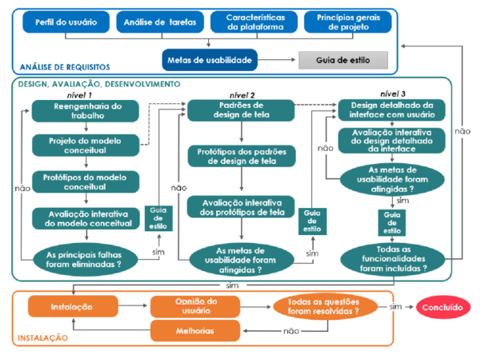

# Requisitos de UX e Metas de Usabilidade

1. **Características da Plataforma**  
   

| Característica | Descrição |
| :---- | :---- |
| Descrição do Software | APP criado para ajudar pessoas idosas na realização de atividades físicas, com acompanhamento médico profissional e exercícios adaptados a necessidade. |
| Descrição do Hardware | Um dispositivo móvel com IOS 15/Android 12 ou acima  |
| LISTA DE Capacidades da Plataforma (com explicação) | Funções de adaptabilidade, restrições médicas e cronograma personalizado, perfil tanto pra idosos quanto pra profissionais. |
| LISTA DE Restrições da Plataforma (com explicação) | Pouca variedade em exercícios. |

2. **Princípios Gerais do Projeto (INCREMENTAR TABELA)**     

| Nome | Descrição | Link |
| :---- | :---- | :---- |
| Descrição do Contexto | .  |  |
| Lei Geral de Proteção de Dados (LGPD) \- Lei n.º 13.709/2018 | A LGPD é a legislação brasileira que regulamenta o tratamento de dados pessoais no Brasil. É importante para o projeto porque estabelece regras sobre como os dados dos usuários devem ser coletados, armazenados, processados e protegidos, garantindo sua privacidade e segurança. | [https://www.planalto.gov.br/ccivil\_03/\_ato2015-2018/2018/lei/l13709.htm](https://www.planalto.gov.br/ccivil_03/_ato2015-2018/2018/lei/l13709.htm) |
| Lei n.º 10.098/2000 \- Lei da Acessibilidade |  Esta lei brasileira estabelece normas gerais e critérios básicos para a promoção da acessibilidade das pessoas com deficiência ou com mobilidade reduzida. É importante para o projeto porque define diretrizes para tornar produtos e serviços, incluindo interfaces de usuário, acessíveis a todos os usuários, independentemente de suas habilidades físicas ou cognitivas. | [https://www.planalto.gov.br/ccivil\_03/leis/l10098.htm](https://www.planalto.gov.br/ccivil_03/leis/l10098.htm) |
| ABNT NBR ISO 9241 Ergonomia da interação humano-sistema |  Esta série de normas brasileiras, baseadas nas normas ISO 9241, fornece diretrizes e orientações para o design centrado no usuário de sistemas interativos, incluindo a concepção de interfaces de usuário. A parte 210 aborda o processo de design centrado no humano, enquanto a parte 11 fornece orientações específicas sobre usabilidade. Essas normas são importantes para o projeto porque estabelecem princípios e métodos para garantir que a interface do usuário atenda às necessidades e expectativas dos usuários. | [https://www.inf.ufsc.br/\~edla.ramos/ine5624/\_Walter/Normas/Parte%2011/iso9241-11F2.pdf](https://www.inf.ufsc.br/~edla.ramos/ine5624/_Walter/Normas/Parte%2011/iso9241-11F2.pdf) |
|  | . |  |

   

3. **Metas de Usabilidade**

   1. **Qualitativo**
O aplicativo deve proporcionar uma experiência simples, intuitiva e acessível para o público idoso, permitindo que os usuários realizem suas atividades sem dificuldades. A interface deve apresentar textos legíveis, botões de fácil identificação e instruções claras. Além disso, deve transmitir segurança e confiança durante o uso, principalmente no cadastro de informações pessoais e condições de saúde. Busca-se também proporcionar autonomia, motivação e satisfação aos usuários, incentivando a prática regular de atividades físicas por meio de planos personalizados e do acompanhamento de profissionais da saúde.

   3. **Quantitativo**  
    
| Metas | Porcentagem | Justificativa |
| ----- | :---- | :---- |
| Facilidade de cadastro | 20% | Pessoas ficam desmotivadas ao ter dificuldades pra cadastrar um usuário. |
| Fácil acessibilidade | 10% | Um aplicativo voltado a idosos precisa ter opções instrutivas. |
| Proposta do app | 50% | Além do app ser voltado a atividade física pra idosos, ele conta com suporte de médicos reais dispostos a ajudar.  |
| Lista de restrições do usuário | 10% | O usuário pode cadastrar suas comorbidades assim gerando um plano mais coeso com suas necessidades. |
| Suporte médico | 10% | Um profissional da saúde estará disponível pra ajudar o idoso caso necessário. |
| **Total** | **100%** | O usuário que procura por um app que entende suas necessidades e ao mesmo tempo oferece suporte e incentivo para atividades físicas terá tudo isso dentro do app. |
